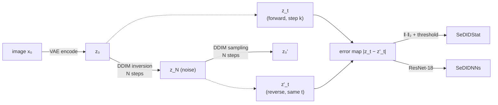

# Latent-Space SeDID: Detecting Diffusion-Generated Images

[](https://github.com/AdityaAji080/SeDID_DL/actions/workflows/tests.yml)

[](LICENSE)

An implementation of **SeDID** (*Stepwise Error for Diffusion-generated Image Detection*, Ma et al., ICML 2023 AdvML-Frontiers workshop), adapted from pixel-space DDPMs to the **latent space of modern text-to-image models** like Stable Diffusion.

The idea is that a diffusion model can reconstruct its own outputs better than it can reconstruct real photos. Invert an image to noise with deterministic DDIM, run the process back, and measure how far the intermediate latents drift. Generated images drift less.

```
python generate.py  →  python invert.py  →  python detect.py
  (fake images)        (z_t, z'_t pairs)      (SeDIDStat + SeDIDNNs)
```

> **Status:** research prototype. The pipeline is verified with automated tests (see [Testing](#testing)). The headline numbers in [`results/`](results/) come from an early pilot with **known confounds**, explained in [Results](#results) and [Limitations](#limitations). Read those sections before the numbers.

---

## How it works



1. **Encode.** Each image is resized to the model's native resolution and encoded with the model's own VAE. The posterior mode is used, so the step is deterministic.
2. **Invert.** `DDIMInverseScheduler` maps `z₀` to noise in `N` steps (η = 0, no guidance), keeping every intermediate latent `z_t`.
3. **Reconstruct.** `DDIMScheduler` maps the noise back, keeping every intermediate `z'_t`.
4. **Pair.** For a chosen step `k`, take `z_t` and `z'_t` at the **same noise level** `t_k`. Inversion is not exact, so the gap between them is the stepwise error.
5. **Detect.**
   - **SeDIDStat** scores each image by `−‖z_t − z'_t‖₂` against a single threshold.
   - **SeDIDNNs** trains a ResNet-18, with its first conv widened to the latent channel count, on the error map `|z_t − z'_t|`.

### What changes in latent space

The original SeDID works on pixels with DDPMs trained on CIFAR-10, CelebA and similar datasets. Moving to latent diffusion adds three things to account for:

- **The VAE is part of the measurement.** A generated image is a VAE decode. Re-encoding it lands close to a latent the model actually produced, which may help detection. A real photo has no such guarantee, so some of the signal may come from the VAE rather than the diffusion model.
- **Conditioning matters.** Inversion runs with each image's text prompt. If real and fake images get prompts from different distributions, that difference can leak into the error.
- **Schedules differ between models.** Epsilon vs. v-prediction, and timestep spacing (`leading` vs. `trailing` for Turbo models), change what "step k" means. Scores aren't directly comparable across models at the same `k`.

---

## Supported models

`invert.py` builds its DDIM schedulers from each model's own scheduler config, so any `diffusers` text-to-image pipeline with a DDIM-compatible (discrete-time) scheduler should work. Pass `--model_id`:

| Model family | Example `--model_id` | Status |
|---|---|---|
| Stable Diffusion 1.x | `stable-diffusion-v1-5/stable-diffusion-v1-5` | Used for the pilot results |
| Stable Diffusion 2.x (v-prediction) | `stabilityai/stable-diffusion-2-1` | Expected to work, untested here |
| SD-Turbo / SDXL-Turbo (`trailing` spacing) | `stabilityai/sd-turbo` | Expected to work, untested here |
| SDXL | `stabilityai/stable-diffusion-xl-base-1.0` | Expected to work, untested here (VAE auto-upcast to fp32) |
| PixArt-α / Σ | `PixArt-alpha/PixArt-XL-2-512x512` | Expected to work, untested here |
| Flow-matching (SD3, FLUX) | — | **Not yet.** Experimental inverted schedules are in `inversion_utils.py` |

The accompanying research (in a separate, private codebase) evaluated this method on **LAION-10k across 9 text-to-image models**, including SD 1.5, SD 2.1, a Turbo variant and PixArt. This repo is the cleaned-up public version of the pipeline.

---

## Installation

Requires **Python 3.12+** (for `itertools.batched`) and a CUDA GPU for anything beyond toy runs.

```bash
git clone https://github.com/AdityaAji080/SeDID_DL.git
cd SeDID_DL
python -m venv .venv && source .venv/bin/activate
pip install -r requirements.txt   # install the right torch build for your CUDA first if needed
```

## Usage

### 1. Prepare images

Every image must be named `<index>_<prompt>.<ext>`, for example `00012_a photo of a cat.png`. The prompt is used to condition inversion.

- **Real images:** put them in `data/real/`, named as above (for example with the caption, or `a photo of a <class>`).
- **Generated images:** `generate.py` writes this format directly.

```bash
python generate.py --prompts_from_file prompts.txt --out_dir data/fake \
                   --model_id stable-diffusion-v1-5/stable-diffusion-v1-5 --seed 0
```

### 2. Invert and reconstruct

```bash
python invert.py data/real --out_dir latents/real --sampler_steps 6 --sedid_steps 2
python invert.py data/fake --out_dir latents/fake --sampler_steps 6 --sedid_steps 2
```

`--sedid_steps` takes one or more step indices `k ∈ [0, N−2]`, for example `1,2,3`. Step `N−1` is rejected because the fully inverted noise is the reverse pass's input, so its error is always 0. Output layout:

```
latents/real/zt/step2/00012_a photo of a cat.pth
latents/real/zt_prime/step2/00012_a photo of a cat.pth
```

Optional flags: `--save_images` (reconstructions), `--save_endpt_latents` (`z₀`, `z_N`, `z₀'`), `--save_all_latents` (full trajectories).

### 3. Train and evaluate the detectors

```bash
python detect.py --real_latents latents/real --fake_latents latents/fake --step 2 \
                 --output_dir outputs/sd15_step2 --variant both
```

Data is split once, **stratified**, into train / val / test (80/10/10 by default):

- SeDIDStat fits its threshold on **train**.
- SeDIDNNs selects its best epoch on **val**.
- Both are reported on **test**, which neither has seen.

Results are appended to `<output_dir>/results.csv` with a `split` column. Metrics: AUC, accuracy, precision, recall, F1, TPR@1% FPR, TPR@0.1% FPR, and the confusion matrix (real = 0, fake = 1).

---

## Results

### Pilot: SD 1.5, CIFAR-10 real vs. SD 1.5 fake ([`results/sd15_cifar10_v0.csv`](results/sd15_cifar10_v0.csv))

| Run | DDIM steps | Detector | AUC | Acc | TPR@1%FPR | Eval set (real / fake) |
|---|---|---|---|---|---|---|
| `sedid_DL6` | 6 | SeDIDStat | 1.000 | 1.000 | 1.000 | 974 / 1026 |
| `sedid_DL6` | 6 | SeDIDNNs | 1.000 | 1.000 | 1.000 | 974 / 1026 |
| `sedid_DL1000` | 1000 | SeDIDStat | 1.000 | 0.999 | 1.000 | 1007 / 327 |
| `sedid_DL1000` | 1000 | SeDIDNNs | 1.000 | 0.998 | 1.000 | 1007 / 327 |

**These numbers should not be read as evidence that latent-space SeDID works.** They come from an earlier version of the code, and three things limit them:

1. **Resolution confound.** The real images are 32×32 CIFAR-10 upscaled to 512×512, while the fakes are native 512×512 SD outputs. Upscaled images are unusually smooth, so the classes are separable without any SeDID-specific signal.
2. **Step pairing changed.** The current `invert.py` pairs each forward latent with the reverse latent at the same noise level, and this is checked against an exactly invertible model in [`tests/`](tests/). The pilot used an earlier indexing, so its scores are not directly comparable with new runs.
3. **Optimistic evaluation, now fixed.** v0 picked the SeDIDStat threshold and the SeDIDNNs checkpoint on the same split it reported on, with no separate test set.

The current code addresses (3) and uses the tested pairing from (2). Fixing (1) means re-running with real images at native resolution, such as LAION, COCO or ImageNet crops at 512×512.

---

## Limitations

- **Dataset bias is the main threat to validity.** Real and fake sets should match in resolution, preprocessing (resize and JPEG history), content distribution and prompt style. Otherwise the detector may learn the dataset rather than the generator.
- **Model attribution, not general detection.** SeDID tests whether an image is easy for *this* model to reconstruct. Detecting images from a different generator than the one used for inversion is a separate, harder question.
- **VAE confound.** Generated images have already passed through the VAE once. Part of the signal may be VAE reconstruction error, not diffusion error. Measuring a VAE-only baseline (`‖E(D(z₀)) − z₀‖`) would separate the two.
- **Step choice is model-dependent.** The most informative `k` depends on N and the noise schedule. It should be tuned per model on the val split.
- **Flow-matching models are not supported yet.**

## Possible next steps

- Re-run the pilot with resolution-matched real images and a VAE-only baseline.
- Sweep `k` and `N` per model; report the AUC curve against step.
- Cross-model evaluation: invert with model A, detect images from model B.
- Robustness to JPEG compression and resizing.
- Wire up the inverted flow-matching schedules for SD3 and FLUX.

---

## Testing

```bash
pip install pytest
pytest -q tests/
```

The tests build a tiny randomly initialised Stable Diffusion pipeline, which runs on CPU with no downloads. They replace its UNet with a zero-noise oracle, which makes DDIM inversion exactly invertible. Then they check that every saved `(z_t, z'_t)` pair matches to float precision, that the trivial final step is rejected, and that prompts round-trip through filenames.

## Repository layout

```
generate.py          # 1. text-to-image generation (fake set)
invert.py            # 2. VAE encode → DDIM inversion → DDIM reconstruction → (z_t, z'_t) pairs
detect.py            # 3. SeDIDStat + SeDIDNNs (ResNet-18), stratified train/val/test
inversion_utils.py   # latent-collecting callbacks, pass-through prepare_latents, inverted schedules
common.py            # shared helpers: device/dtype, native resolution, file naming
tests/               # CPU-only correctness tests (run in CI)
results/             # result tables
```

## Citation

This repo implements, and is not affiliated with, the following paper:

```bibtex
@inproceedings{ma2023exposing,
  title     = {Exposing the Fake: Effective Diffusion-Generated Images Detection},
  author    = {Ma, RuiPeng and Duan, Jinhao and Kong, Fei and Shi, Xiaoshuang and Xu, Kaidi},
  booktitle = {ICML 2023 Workshop on Adversarial Machine Learning Frontiers (AdvML-Frontiers)},
  year      = {2023},
  url       = {https://arxiv.org/abs/2307.06272}
}
```

## Acknowledgements

- Inverted scheduler utilities in `inversion_utils.py` are adapted from [🤗 diffusers](https://github.com/huggingface/diffusers) (Apache-2.0), with modifications by A. Sindhu and J. Styborski.
- Built on [PyTorch](https://pytorch.org/), [diffusers](https://github.com/huggingface/diffusers) and [torchvision](https://pytorch.org/vision/).

## License

[MIT](LICENSE). Code adapted from diffusers remains under its original Apache-2.0 license.
